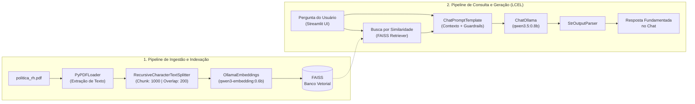

# Assistente RAG Local — Políticas Internas de RH


Um assistente conversacional inteligente baseado em **RAG (Retrieval-Augmented Generation)** capaz de responder dúvidas sobre documentos corporativos e políticas internas de Recursos Humanos (**PDF**) executando **100% localmente**, sem custo de API e com total privacidade de dados.

---

## Visão Geral e Impacto de Negócio

Empresas possuem manuais extensos de políticas internas (férias, benefícios, trabalho remoto, conduta) que colaboradores consultam diariamente. Ao mesmo tempo, enviar documentos corporativos sensíveis para APIs externas pode gerar custos recorrentes e riscos de conformidade (**LGPD / confidencialidade**).

Este projeto resolve ambos os desafios ao implementar:
- **Privacidade Total (On-Premise / Local):** Tanto a vetorização (Embeddings) quanto a geração de respostas (LLM) rodam localmente via **Ollama**.
- **Mitigação de Alucinações (Grounded Generation):** O agente é instruído via engenharia de prompt a responder **exclusivamente** com base nos trechos recuperados do documento oficial (`politica_rh.pdf`).
- **Arquitetura Modular com LCEL:** Construído com *LangChain Expression Language*, permitindo alternar facilmente entre modelos locais (`ChatOllama`) e provedores em nuvem (`ChatOpenAI`).

---

## Arquitetura do Sistema (Pipeline RAG)

O fluxo abaixo ilustra as duas etapas principais da aplicação: **Ingestão/Indexação Documental** e **Recuperação/Geração Conversacional**.



---

## Tecnologias Utilizadas

| Camada | Tecnologia | Responsabilidade no Projeto |
| :--- | :--- | :--- |
| **Interface Web** | [Streamlit](https://streamlit.io/) | Interface de chat interativa com gerenciamento de estado de sessão (`st.session_state`). |
| **Orquestração IA** | [LangChain (LCEL)](https://www.langchain.com/) | Encadeamento declarativo entre retriever, template de prompt, LLM e parser de saída. |
| **LLM Local** | [Ollama](https://ollama.com/) (`qwen3.5:0.8b`) | Modelo de linguagem leve e rápido para geração de respostas em português. |
| **Embeddings** | [Ollama](https://ollama.com/) (`qwen3-embedding:0.6b`) | Conversão dos blocos de texto e perguntas em vetores densos de alta dimensão. |
| **Banco Vetorial** | [FAISS (Meta AI)](https://faiss.ai/) | Indexação em memória e busca eficiente por similaridade semântica em CPU (`faiss-cpu`). |
| **Processamento PDF** | [PyPDF](https://pypdf.readthedocs.io/) | Leitura e extração estruturada das páginas do documento `politica_rh.pdf`. |

---

## Destaques Técnicos da Implementação

1. **Chunking Inteligente com Sobreposição:**
   - Utilização do `RecursiveCharacterTextSplitter` com `chunk_size=1000` e `chunk_overlap=200`, garantindo que parágrafos e regras de RH não percam o contexto semântico nas bordas de divisão.
2. **Pipeline Declarativo com LCEL (`LangChain Expression Language`):**
   ```python
   chain = (
       {"context": buscador_contexto, "question": RunnablePassthrough()}
       | prompt_template
       | llm
       | StrOutputParser()
   )
   ```
3. **Guardrails Contra Alucinação:**
   - O `ChatPromptTemplate` restringe o escopo do modelo apenas ao contexto recuperado pelo FAISS e exige declaração explícita quando a informação não consta na política interna.

---

## Estrutura do Projeto

```text
AgenteRagLocal/
├── app_gabarito.py          # Aplicação principal (RAG Local com suporte a extensões OpenAI/Ollama)
├── app_gabarito_ollama.py   # Versão dedicada 100% à stack local com Ollama
├── politica_rh.pdf          # Documento base com as políticas internas de RH da empresa
├── requirements.txt         # Dependências do projeto Python
└── README.md                # Documentação técnica do projeto
```

---

## Como Executar o Projeto Localmente

### 1. Pré-requisitos
- **Python 3.10+** instalado.
- **[Ollama](https://ollama.com/)** instalado e em execução na máquina.

### 2. Baixar os Modelos no Ollama
No terminal, faça o download do modelo de embeddings e do LLM utilizados pelo agente:

```bash
ollama pull qwen3-embedding:0.6b
ollama pull qwen3.5:0.8b
```

### 3. Configurar o Ambiente Python
Clone o repositório, crie o ambiente virtual e instale as dependências:

```bash
# Criar ambiente virtual
python -m venv .venv

# Ativar ambiente virtual (Windows PowerShell)
.\.venv\Scripts\Activate.ps1

# Ativar ambiente virtual (Linux/macOS)
# source .venv/bin/activate

# Instalar dependências
pip install -r requirements.txt
```

### 4. Iniciar a Aplicação
Execute o servidor do Streamlit:

```bash
streamlit run app_gabarito.py
```

A aplicação abrirá automaticamente no navegador em `http://localhost:8501`.

---

## Exemplos de Perguntas para Testar

Ao abrir o chat, experimente perguntar:
- *"Como funciona a política de férias da empresa?"*
- *"Quais são as regras sobre trabalho remoto ou home office?"*
- *"Quais benefícios são oferecidos aos colaboradores?"*
- *"Qual o procedimento em caso de ausência ou atestado médico?"*
- *"Qual é a receita de bolo de chocolate?"* *(Teste de guardrail: o assistente recusará responder por estar fora do documento).*
